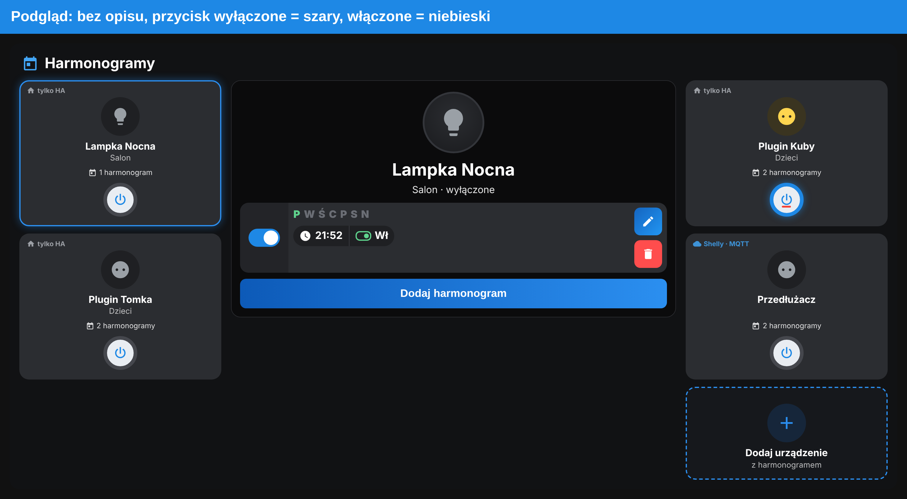

# 📅 Harmonogramy Shelly

Harmonogramy w wyglądzie aplikacji Shelly: kafelki urządzeń, dni tygodnia, godziny, włącz/wyłącz. Dane trzyma integracja **Scheduler** (HACS: `scheduler-component`).



## Co potrafi

- Bez `entity`: karta uniwersalna z kafelkami urządzeń i przyciskiem „Dodaj urządzenie”.
- Z `entity`: karta jednego urządzenia.
- Obsługuje gniazdka, światła, rolety, TV, wentylatory, przełączniki, skrypty, sceny i odkurzacze.

## Wymagania

- Integracja Scheduler (HACS → Integracje → „Scheduler”).

## Instalacja

1. Skopiuj `shelly-schedule-card.js` do `/config/www/`.
2. **Ustawienia → Pulpity → ⋮ → Zasoby → Dodaj zasób**: `/local/shelly-schedule-card.js`, typ **Moduł JavaScript**.
3. Odśwież przeglądarkę (Ctrl+Shift+R).

```yaml
type: custom:shelly-schedule-card
```

## 📜 Licencja

[CC BY-NC-SA 4.0](../../LICENSE) – autor: [superdarco78](https://github.com/superdarco78).
