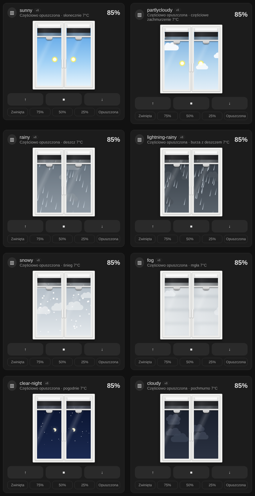
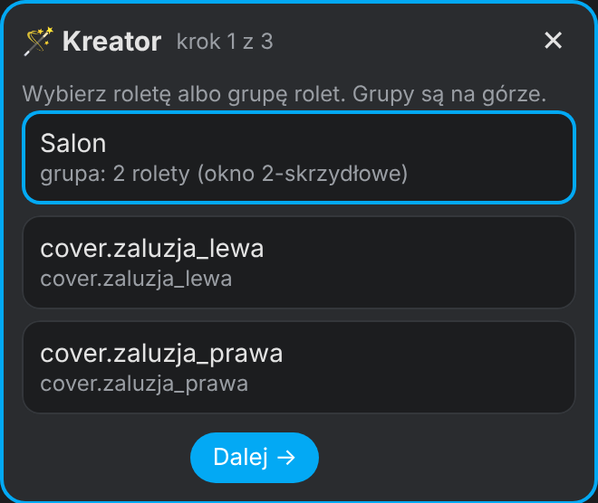
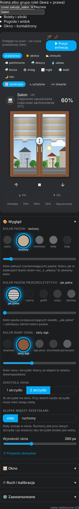

# 🪟 Roleta dzień-noc (`roleta-realistyczna`) – v22

Roleta dzień-noc (zebra) na prawdziwym oknie z 1 albo 2 skrzydłami. Roletę przesuwasz palcem, animacja jedzie w tempie silnika, a za szybą widać aktualną pogodę z Home Assistanta.



## Co potrafi

- 3 uchwyty: listwa skrzydła rusza jedno skrzydło, okrągły uchwyt na środku rusza oba.
- Animacja w tempie silnika (z encji `number.*_motor_speed` silników Moes) i odporność na fałszywe meldunki 0%/100% z Zigbee.
- Pogoda za oknem z encji `weather.*`, noc z księżycem i gwiazdami, rysowany widok albo własne zdjęcie (`tlo`).
- Edytor graficzny z żywym podglądem i 🪄 kreatorem w 3 krokach.

| Kreator | Menu edytora |
|---|---|
|  |  |

## Instalacja

1. Skopiuj `roleta-realistyczna.js` do `/config/www/`.
2. **Ustawienia → Pulpity → ⋮ → Zasoby → Dodaj zasób**: `/local/roleta-realistyczna.js`, typ **Moduł JavaScript**.
3. Odśwież przeglądarkę (Ctrl+Shift+R).
4. **Edytuj pulpit → Dodaj kartę → „Roleta dzień-noc”**. Kreator otworzy się sam.

```yaml
type: custom:roleta-realistyczna
entity: cover.zaluzje_salon   # roleta albo grupa rolet (lewa + prawa)
name: Salon
```

Pełna historia zmian jest na początku pliku `.js`.

## 📜 Licencja

[CC BY-NC-SA 4.0](../../LICENSE) – autor: [superdarco78](https://github.com/superdarco78).
