# 🪟 Roleta dzień-noc

[](https://github.com/superdarco78/HA/releases?q=roleta-realistyczna)
[](https://www.home-assistant.io/)
[](#)
[](../../LICENSE)

Realistyczna roleta dzień-noc (zebra) na prawdziwym oknie. Roletę przesuwasz palcem, animacja jedzie w tempie silnika, a za szybą widać aktualną pogodę i porę dnia.

*Realistic day-night (zebra) roller blind card for Home Assistant: drag to move, animation follows the motor, live weather outside the window.*

<p align="center">
  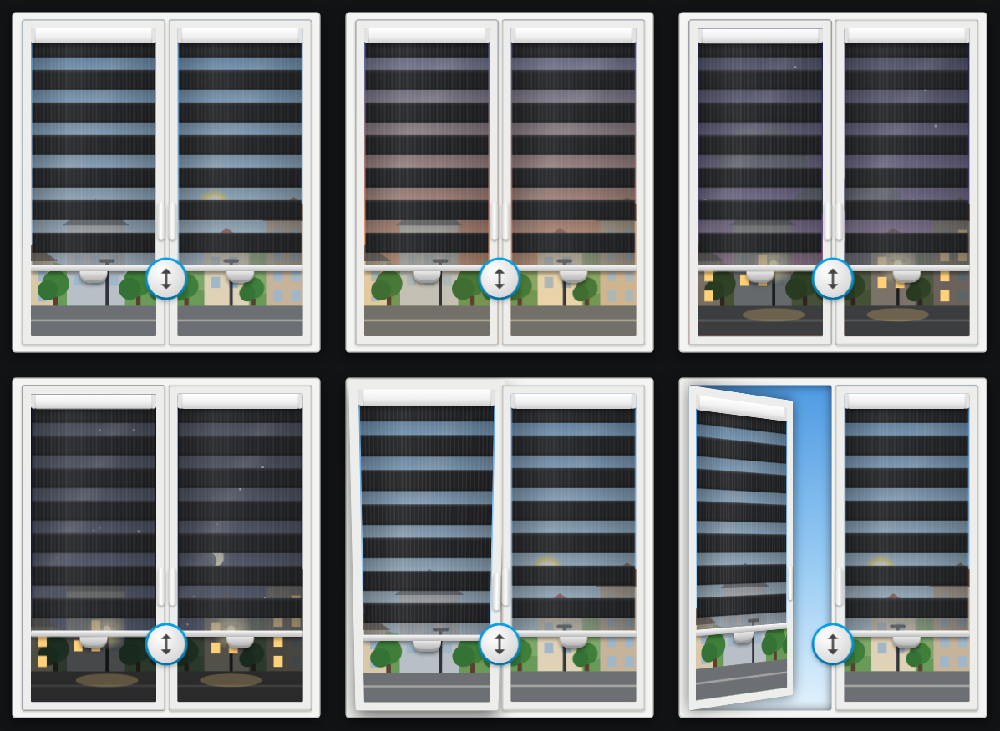
  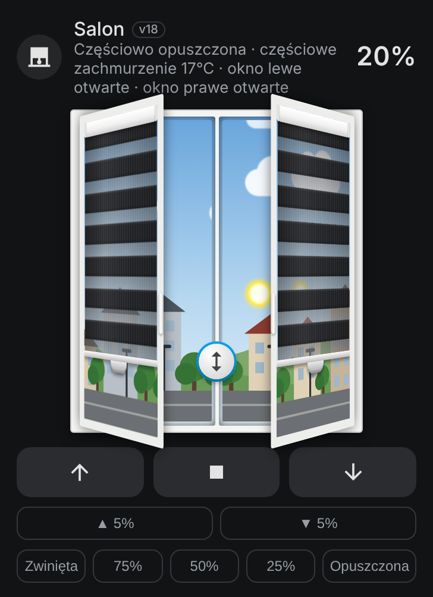
  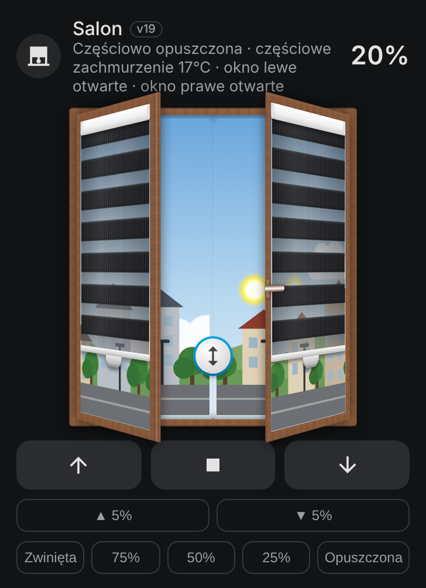
</p>

<p align="center">
  <a href="https://github.com/superdarco78/HA/releases/download/roleta-realistyczna-v22/roleta-realistyczna.js"><b>⬇️ Pobierz roleta-realistyczna.js (v22)</b></a>
</p>

---

## ✨ Co potrafi

| | |
|---|---|
| 🪄 **Kreator** | Przy dodaniu karty sam się otwiera: wybierasz roletę, karta pokazuje, co wykryła, i gotowe. |
| 👆 **Sterowanie palcem** | Uchwyt na listwie rusza jedno skrzydło, okrągły uchwyt na środku oba. Dotknięcie w trakcie jazdy = STOP. |
| ⏱ **Animacja 1:1 z silnikiem** | Tempo z prędkości silnika albo z kalibracji jednym przyciskiem. Fałszywe meldunki Zigbee (0% / 100%) nie psują animacji. |
| 🌦 **Pogoda za oknem** | Słońce, chmury, deszcz, burza, śnieg, mgła, wiatr. Bez integracji pogody karta sama pobiera ją z internetu (Open-Meteo, bez klucza). |
| 🌅 **Pora dnia** | Dzień, złota godzina, zmierzch i noc z księżycem i gwiazdami, według słońca w HA. |
| 🪟 **Okno jak prawdziwe** | Uchylone albo otwarte według kontaktronu, klamki, słupek stały lub ruchomy, 1 albo 2 skrzydła. |
| 🎨 **Kolory jak w sklepie** | Tkaniny dzień-noc, okleiny drewnopodobne (złoty dąb, orzech, winchester…) i kolory gładkie. |
| 🔍 **Sama wykrywa** | Prędkość silnika z tego samego urządzenia, kontaktrony z tego samego pomieszczenia, grupę rolet. |
| 🌍 **Język** | Polski albo angielski, automatycznie według ustawień HA. |

---

## ⬇️ Instalacja krok po kroku

Potrzebujesz dodatku **File editor** (Ustawienia → Dodatki → Sklep z dodatkami → File editor → Zainstaluj → „Pokaż na pasku bocznym”).

### Krok 1. Pobierz plik

Kliknij **[⬇️ Pobierz roleta-realistyczna.js](https://github.com/superdarco78/HA/releases/download/roleta-realistyczna-v22/roleta-realistyczna.js)** albo wejdź w [Wydania](https://github.com/superdarco78/HA/releases?q=roleta-realistyczna) i kliknij plik `.js`.

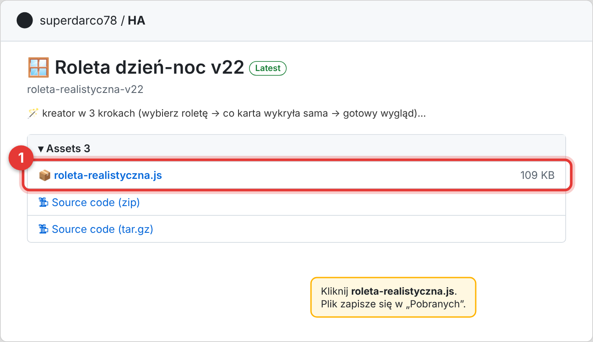

### Krok 2. Wgraj plik do Home Assistanta

Otwórz **File editor** z menu po lewej.

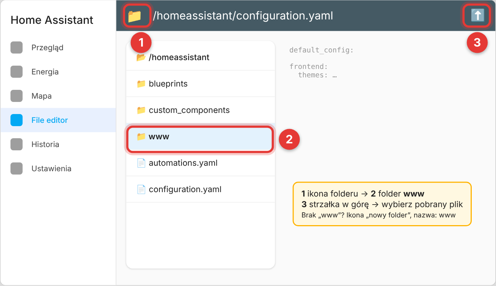

### Krok 3. Otwórz Pulpity

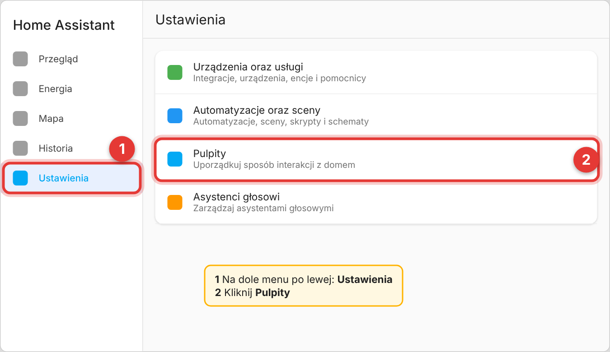

### Krok 4. Otwórz Zasoby

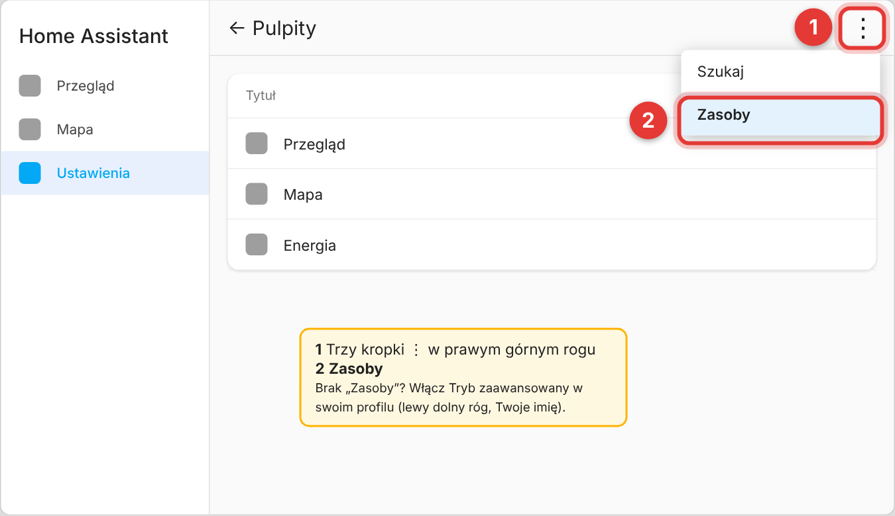

### Krok 5. Dodaj zasób

Adres: `/local/roleta-realistyczna.js`, typ: **Moduł JavaScript**. Potem odśwież stronę: **Ctrl + Shift + R**.

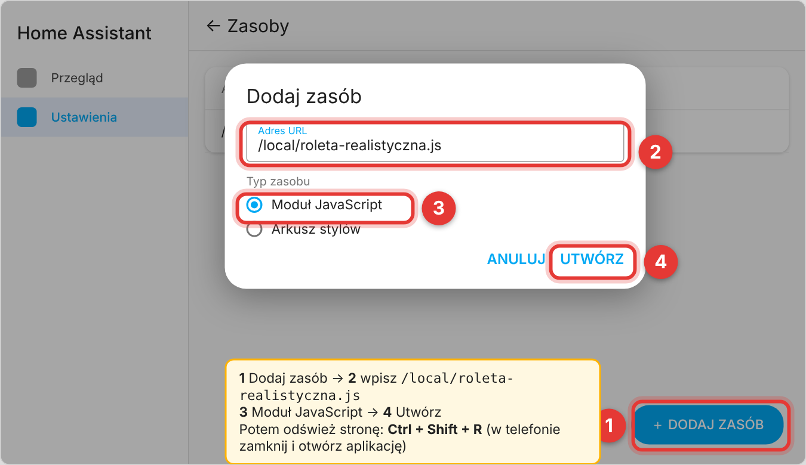

### Krok 6. Dodaj kartę na pulpit

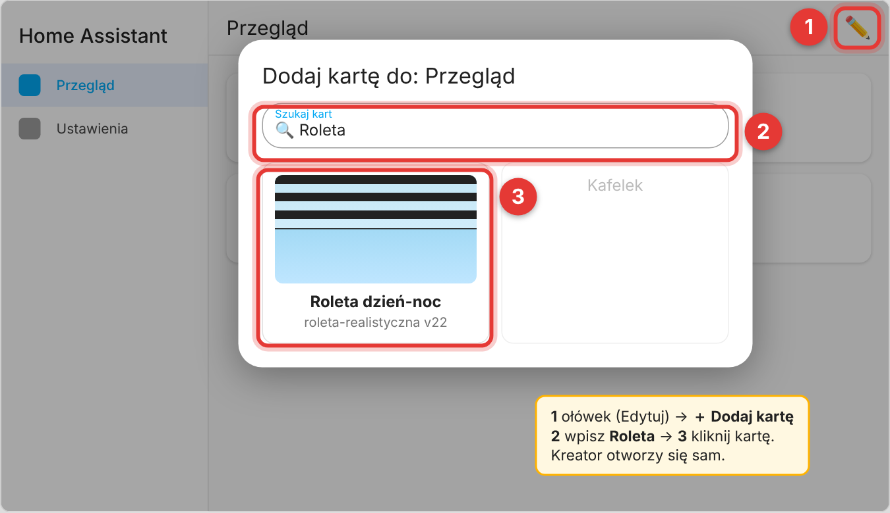

### Krok 7. Kreator zrobi resztę

<p>
  
  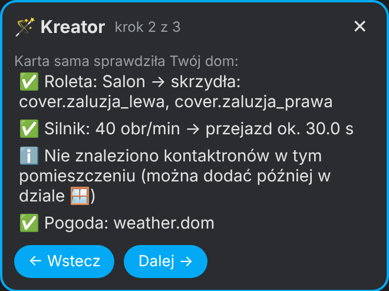
  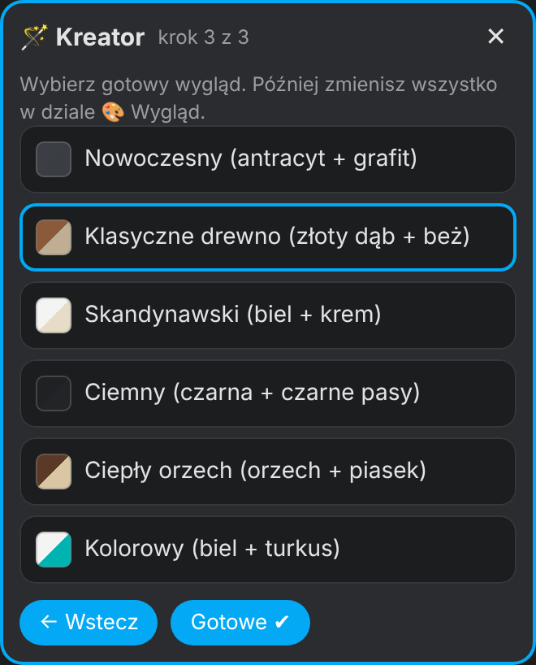
</p>

✅ Gotowe. Wszystko inne zmienisz później w edytorze karty (ołówek na pulpicie → kliknij kartę).

---

## 🎛 Edytor

Ustawienia są w rozwijanych działach: 🎨 Wygląd, 🪟 Okno, ⏱ Ruch i kalibracja, ⚙️ Zaawansowane. Na górze podgląd na żywo, który nie rusza prawdziwej rolety.

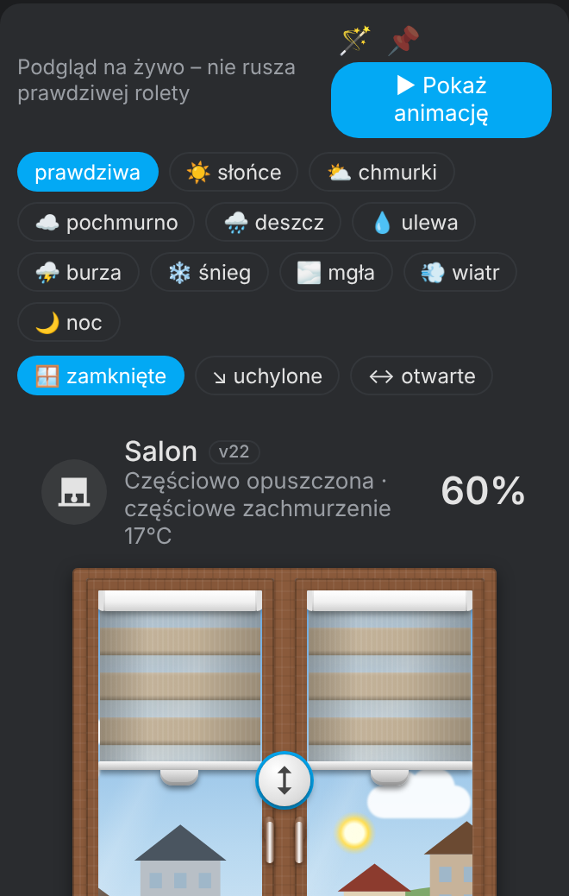

<details>
<summary><b>Konfiguracja w YAML (dla zaawansowanych)</b></summary>

```yaml
type: custom:roleta-realistyczna
entity: cover.zaluzje_salon   # roleta albo grupa rolet (lewa + prawa)
name: Salon
```

Wszystkie pozostałe opcje ustawisz w edytorze graficznym.
</details>

---

## 🔄 Aktualizacja

1. Pobierz nowy plik z [Wydań](https://github.com/superdarco78/HA/releases?q=roleta-realistyczna).
2. W File editor wgraj go do `www` w miejsce starego.
3. Odśwież stronę: **Ctrl + Shift + R**.

Co się zmieniło w każdej wersji: [📝 Historia zmian](CHANGELOG.md).

## ❓ Problem?

- Nie ma karty na liście? Sprawdź krok 5 i odśwież stronę (Ctrl + Shift + R).
- Coś działa źle? [Zgłoś błąd](https://github.com/superdarco78/HA/issues/new/choose).

## 📜 Licencja

[CC BY-NC-SA 4.0](../../LICENSE) – autor: [superdarco78](https://github.com/superdarco78).
