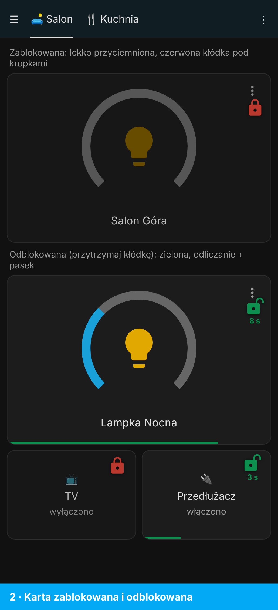
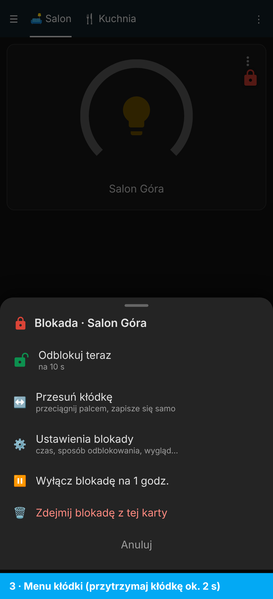

# 🔒 Blokada kafelka

Kłódka na dowolną kartę pulpitu. Zablokowanej karty nie da się kliknąć przez przypadek (np. dziecko, kieszeń). Odblokowanie przytrzymaniem, dwuklikiem, PIN-em albo potwierdzeniem, potem sama blokuje się po kilku sekundach.

| Zablokowana / odblokowana | Menu kłódki |
|---|---|
|  |  |

## Co potrafi

- Przytrzymaj dowolną kartę 3 s = menu „Dodaj blokadę” (bez trybu edycji).
- W trybie edycji pod każdą kartą przycisk „Dodaj / Zdejmij blokadę”.
- Przytrzymaj kłódkę ok. 2 s = menu: odblokuj, przesuń, ustawienia, wyłącz na 1 h, zdejmij.
- Harmonogram blokady (np. 22:00–06:00), wyjątki dla wybranych użytkowników, wibracja.
- Wspólne ustawienia dla wszystkich kłódek: karta `custom:blokada-ustawienia` na pulpicie „🔒 Blokady”.

## Instalacja

1. Skopiuj `blokada-kafelka.js` do `/config/www/`.
2. **Ustawienia → Pulpity → ⋮ → Zasoby → Dodaj zasób**: `/local/blokada-kafelka.js`, typ **Moduł JavaScript**.
3. Odśwież przeglądarkę (Ctrl+Shift+R).

```yaml
type: custom:blokada-kafelka
unlock: hold        # hold / double_tap / pin / confirm
duration: 10        # po ilu sekundach sama się zablokuje
card:
  type: tile
  entity: light.salon
```

## 📜 Licencja

[CC BY-NC-SA 4.0](../../LICENSE) – autor: [superdarco78](https://github.com/superdarco78).
